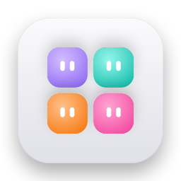

# Alotbot

A group voice call with your own Grok Bots, as a native Mac app.

## Not affiliated with xAI

- This is an independent personal project. It is not made, endorsed or supported by xAI.
- Grok, Grok Bot and xAI are trademarks of xAI and are used here only to describe what this works with.
- The Mac app's avatar shapes, eye shapes and animation timing (`mac/Sources/AlotbotCore/Resources/morph-data.json`) come from the Grok Bot app, so the bots look the same as they do there. That design belongs to xAI. It's included only for that compatibility, and `mac/tools` has the scripts that read it from your own installed copy of Grok Bot.
- Grok Bot has no public API. The app talks to Grok Bot's private endpoints with your own signed-in account, the same way the Grok Bot desktop app (v0.79.4) does. They may change or break, and sign-in or voice may then stop working until this app is updated. xAI's Acceptable Use Policy bars access "through unauthorized bots or scripts", so using them may go against xAI's terms. You use it at your own risk and are responsible for your own account.
- If you are from xAI and want anything changed or removed, open an issue or email via [shashankdev03.me](https://shashankdev03.me) and it will be done promptly.
- No warranty.

## What it does

- **Join and leave** a voice call, from the menu bar or a small floating call window.
- **Pick which bots are in it**: any of your Grok Bots, before the call and during it.
- **Hear them**: each bot speaks in its own Grok voice (the voice set in the Grok Bot app).
- **Talk with them**: your mic goes to the bot you're talking to. Name a bot and it's a one-on-one: only that bot answers until you're done, then the others may add a suggestion.
- **They talk to each other**: each bot hears what the others say and they take turns on their own.
- **Correct them**: what you say or type comes first, and corrections are pinned for every bot.
- **Shared tasks, timeline, web and X search**, and a saved summary that the next call starts from.
- **Bots can pull other bots in** when you ask, or on their own when another bot would help.
- **Bots keep their Grok Bot tools**: background jobs, connected apps (Gmail, GitHub and the rest of what your Grok account has connected), approvals, and the results coming back into the call.
- **Bot workspaces** in the Mac app: each bot's activity, skills, routines, files, MCP apps, drafts (preview, edit, send or discard), questions and approvals.
- **The cloud computer**: watch a bot's Linux screen, take control, and hand it back.
- **Connections**: see, add, check and remove your connected apps.
- **Look at your Mac**: with your permission, bots can read an app window you name (even in the background or on another Space), files or one folder you allow, or a dedicated browser profile.
- **Call history the bots remember**: every call and meeting is saved and searchable. Bots look up earlier calls themselves ("what did we decide about pricing?"), every summary records the decisions made, and you can continue any earlier call with the bots you choose.
- **Bots call you**: standing calls (for example a weekday standup at 9:30 with an agenda), call backs a bot promises during a call, and a call when a job from an ended call finishes or needs your OK. Quiet hours, do not disturb and missed calls included.
- **Your bots in your meetings**: they follow a Zoom, Teams, Meet, FaceTime or other meeting, transcribed on this Mac, and whisper to you in text (or aloud on headphones). Nobody in the meeting hears them. Hold ⌥Space to talk to them.
- **Share your screen**: share a window or your whole screen; the bots read its text, get what changed with each thing you say, and can look at all of it.

It uses your Grok Bot sign-in and plan. No API key, no extra account.

## Install

Alotbot is one app. Nothing else to install: Node and the backend are inside it, and it runs on Apple Silicon and Intel Macs.

**One line** (downloads the latest release, checks its signature, puts it in Applications and opens it; run it again to update):

```bash
curl -fsSL https://raw.githubusercontent.com/shashank03-dev/alotbot/main/scripts/install.sh | bash
```

**Or by hand:** download `Alotbot-macOS.zip` from the [latest release](https://github.com/shashank03-dev/alotbot/releases/latest), unzip it and move `Alotbot.app` to Applications. The app is not signed with an Apple Developer ID, so the first time macOS says it can't check it. Click **Done**, then open **System Settings › Privacy & Security**, scroll down to "Alotbot was blocked" and click **Open Anyway**. You do this once. The one-line install doesn't need it.

Alotbot lives in the menu bar. Sign in with your Grok account the first time (a browser tab opens the Grok sign-in page). The first Join asks for Microphone, Screen Recording and Accessibility, once each. Updates are signed with the same certificate, so macOS keeps those permissions.

The bots call you by the first name of your macOS account.

### Requirements

- macOS 14 or newer (the window-reading tools need macOS 15.2 or newer).
- A Grok account with Grok Bots. You make and set up the bots (name, voice, look) in the Grok Bot app. Some setup steps, such as Messages, 1Password and notification permission, still hand off to the Grok Bot app.
- A microphone. Headphones are best; see [Echo](#echo).
- For the dedicated browser tool only: Google Chrome or Microsoft Edge. It runs on its own profile, not your everyday one.

## Build from source

Needs the Xcode command line tools with Swift 6 (`xcode-select --install`) and Node.js 22.18 or newer (tested on 26.11.1). Node runs the TypeScript files directly, so there is no build step for the backend.

```bash
git clone https://github.com/shashank03-dev/alotbot.git
cd alotbot
npm install
bash mac/build-app.sh
open "mac/build/Alotbot.app"
```

`mac/build-app.sh` checks Node, runs `swift build -c release`, and puts `Alotbot.app` in `mac/build/`. This developer build runs this folder's backend (`src/overlay/main.ts`) with the Node it found at build time, so keep the folder where it is, or rebuild after moving it. Set `ALOTBOT_NODE=/path/to/node` to pick a different Node.

`bash mac/build-app.sh --release` makes the download instead: one universal app with Node (checked against nodejs.org's checksums) and the backend's runtime packages inside, zipped to `mac/build/Alotbot-macOS.zip`.

The first build creates a self-signed certificate named "Alotbot Local Signing" in your login keychain and signs the app with it, so macOS keeps the app's Microphone, Screen Recording and Accessibility permissions across rebuilds. The `alotbot` password in the script only protects the temporary file used to import that certificate; it is not a secret.

### Releasing

There is no CI. `bash mac/release.sh notes.md` runs every check (`npm test`, `npm run typecheck`, `bash mac/test.sh`), builds the download, pushes, and creates or updates the GitHub release `v<version from package.json>` with `Alotbot-macOS.zip`. Bump `version` in `package.json` for a new release. Releases must be signed with the same certificate, so updates keep their permissions and `scripts/install.sh` accepts them.

### Browser version

There is also a browser version of the call, without the Mac app features:

```bash
npm start
```

Open the link it prints (`http://127.0.0.1:8787/#t=...`). The `#t=` part is a key made for each run: without it the page can't reach your account, so other programs and other users on this Mac can't either.

1. **Sign in.** The first time, click *Sign in*. A tab opens with the same sign-in page the Grok Bot app uses. Log in with your Grok Bot account. The page updates by itself.
2. **Pick bots.** Tick the bots you want, then *Join call*. Allow the microphone.
3. **Talk.** Speak normally. The bot marked *Listening to you* hears you. Say a bot's name ("Shashank's X bot, what do you think?") to talk to that one. Or type in *Message all bots* and press Enter. Press **Esc**, or just say "stop" (or "wait", "hold on", "be quiet", "let me talk"), to stop every bot at once; they wait until you speak again.
4. **See tasks and the timeline** with their buttons. **Change who's in the call** with the People button. **Mute** with the mic button. **Leave** with the red button: one bot writes a summary and action items (up to 20 seconds), then the call is saved and you can download it.

Set `PORT=9000` (or `HOST=localhost`) in the environment or a `.env` file to change where it listens. It only listens on this machine.

## How the call works

- On join, each picked bot gets its own live voice session (Grok voice, `grok-voice-3.0`), with that bot's own voice-call instructions from Grok Bot plus a note that it's in a group call and who else is there.
- When Grok provides greeting directions, the first bot gives you 15 seconds to speak first, then opens with its greeting. Older sessions without greeting directions open immediately.
- **Your mic** goes to one bot at a time: the last bot that spoke, or the bot you named. Grok voice sessions always reply to audio they hear, so sending your voice to every bot would make them all answer at once. The other bots get your words as text: `[<your name> (host)]: ...`. Every bot is told that what the host says comes before the current topic.
- **Bot to bot**: when a bot finishes, the others get its words as `[Bot name]: ...`. Then the bot it named answers, or the next bot in line. There is no fixed turn limit; the bots manage turns with tools:
  - `hand_to`: give the next turn to one bot.
  - `pass`: skip a turn without speaking. If every bot passes in a row, they wait for you. After a bot speaks, if every other bot passes, they wait for you too: the turn does not go back to that bot to say it again in new words.
  - `wait_for_host`: stop the bot-to-bot talk until you speak.
  - `leave_call`: the bot says goodbye and leaves once its voice has finished.
- **Interrupting**: start talking and every bot goes quiet at once. A bot you cut off is told how much of its answer you actually heard, and the other bots get only that part, tagged `(cut off by the host)`.
- **Current direction**: when you correct the bots (a line of 3+ words with "no", "wait", "stop", "actually" or "wrong"), your words are pinned in every bot's instructions as the current direction, newest last, up to 5. Bots that join or reconnect later get it too.
- **Typing**: a typed message counts as you speaking. Whoever is talking is cut off, every bot gets it as `[<your name> (host)]: ...`, a correction is pinned, and the bot you name (or the listening bot) answers. Messages are cut to 1,000 characters.
- **Stop hotkey**: **Esc** silences every bot, drops any queued turn, and the bots wait for you. If your focus is inside a side panel, Esc closes the panel instead.
- **One-on-one**: name one bot ("My Bot, what's the plan?") and only that bot talks with you. Follow-ups without a name go to it too. The other bots keep listening, so they know what was said, but stay silent; their tiles say *Staying quiet*. It ends when:
  - you wrap up ("thanks", "got it", "that's all", "perfect", up to 6 words), or you say nothing for 20 seconds after the bot's reply. Then each other bot, in turn, may add one short suggestion, but only if it has a specific one it fully understands; otherwise it passes silently. After that the call waits for you.
  - you name another bot: the one-on-one moves to that bot.
  - you talk to everyone ("everyone", "guys", "all of you") or name two or more bots: back to group talk, with no suggestion round.
  - the bot leaves or drops.
  In a one-on-one the bot can't hand the turn to another bot. Esc or "stop" keeps the one-on-one but stops its 20-second clock.
- **Saying or typing stop**: a short line that only tells the bots to stop ("stop", "wait", "hold on", "hang on a sec", "be quiet", "shut up", "let me talk", "okay guys, stop talking", up to 8 words, bot names allowed) works like Esc. Nobody answers it, and it is not pinned as a direction. A longer line like "wait, I meant the other plan" is a correction instead: it is pinned and the listening bot answers.
- **Loop breakers**: the app stops the round itself, without waiting for a bot to use `wait_for_host`, when a bot says again what one of the last 6 bot lines already said. After using a tool, a bot is asked to speak again at most 3 times in a row (whether or not it spoke), or 8 times while each round uses a connected-app tool, since app work like creating a chat and sending it a prompt takes more steps; then the turn moves on and the Timeline says so; a repeated line gets no follow-up at all. Anything asked for before you cut in (queued replies, reply nudges, the next bot's turn) is dropped when you cut in.
- **Timeline**: the clock button shows the call as it happens, with times: joins and leaves, every line (cut-off lines marked), tool use, task changes, pinned direction, stops and errors. It keeps the last 500 entries.
- **Stuck mic**: if the call thinks you are still talking but your mic has been quiet for 8 seconds and no words came through, it stops waiting and the listening bot answers.
- Voices never overlap: all bot audio plays on one timeline.
- A bot that drops reconnects by itself with the conversation so far. A bot added mid-call also gets the conversation so far.
- **Shared tasks**: bots use `add_task`, `done_task` and `list_tasks`. Other bots receive a short `[Tasks]: ...` message when a task changes. The Tasks panel shows action items and pinned host corrections. Free-form note taking is removed; notes in old call exports are preserved.
- **Web and X search**: every bot gets xAI's built-in `web_search` and `x_search` tools, which run on xAI's side. If a bot's voice session refuses them, that bot joins without search and its tile says *Search off*.
- **Connected apps, directly on the call**: every bot gets `list_connected_apps`, `find_app_tools`, and `use_app_tool`. They discover your actual Grok-connected apps, read the matching tool schemas, and execute the exact discovered tool using the speaking bot's identity and your existing sign-in. The result returns to that bot's voice session so it can answer on the call. There is no separate API key or connector setup. Try: "List the apps connected in Grok, then check my Gmail connection."
  - App names and connection states come from Grok, rather than a fixed list. Multiple accounts are identified separately. Skills-only plugins are not app connectors.
  - Disabled apps and tools, blocked permissions, and expired sign-ins are reported. Permissions follow Grok Bot's order: a tool's own rule, then your reads or writes rule. With no rule (Grok's default, auto review) a tool runs without asking, reads and changes alike, the way Grok Bot works for you. A tool set to blocked or needs approval in Grok does not run from a call, and the bot tells you. The call does not change those rules. Grok Bot's auto review, which checks actions inside its own agent, does not run on these direct calls.
  - Tool search ranks tools by how many of the query's words they match, so a long spoken query still finds them. Browsing with no query, or a search with no match, also lists every tool name, so a bot never decides an app has nothing more from its first page.
  - Speed: each bot is told which apps are connected when it joins, so it goes straight to the app's tools (a late or failed list falls back to the last one from the past 10 minutes, and adds at most 0.25 s to a join). Before an action, the app list, the app's tool list and your permission rules load at the same time, not one after another, and a tool search may reuse an app's tool list for a minute. Measured on a real account: a search went from about 1.0 s to 0.4 s, and a T3 Code action from about 3.2 s to 1.9 s. The rest is the app's own time on Grok's side.
  - Discovery refreshes before execution. An invented or stale tool name is refused. An action is not automatically retried after a failure or timeout, because it may already have completed.
- **Background bot work**: Grok's own `send_task` and `search_conversations` tools remain available for work on the bot's computer and searching its history. `send_task` gives a background receipt, and what the bot's agent sends back about the job comes back into the call (see **Job results** below). Connected-app work uses the direct tools above instead: the group rules and `send_task`'s own description (as the call offers it) tell every bot never to send anything a connected app can do (your X posts and their numbers, mail, GitHub, T3 Code) as a background job, even after a search came up empty. Without native Mac tools, `send_task` is for work on your computer, files or browser, and for anything you ask to be done on your computer (a terminal command such as `gh` or `git`, a file, a Mac app), even if a connected app could do it too. Duplicate pending and accepted background requests are blocked, and failures get a follow-up. When Grok Bot accepts a bot's job, every other bot in the call is told `[Call]: <bot> sent its agent a background job: "..."` and to leave that work to it unless you ask them by name, so one request doesn't become a job per bot. Refused and failed jobs are not announced. Grok's `end_the_call` is left out because "stop" must not hang up the group.
- **Job results and action history**: the backend records each tool before dispatch in SQLite (`actions.sqlite`), with its bot, call, execution target, status, timestamps and result. It polls Grok transcripts with `beforeSeq`, retains request mappings across pages and restarts, and deduplicates replayed entries. Background jobs keep being watched after Leave and resume when the backend starts again. Polls run every 3 seconds during a call or a recent job, then every 15 seconds, for up to 24 hours. Voice reads local history every 3 seconds. Agent results and typed chat messages use held `async_update` entries; a server that refuses those gets seeded tool items instead. The Mac app shows Actions during and after calls; select a row for its full result. Running direct actions interrupted by a restart become **Outcome unknown**, and are never replayed automatically.
- **Approvals**: pending Grok Auto Review and Mac permission requests appear with their exact action ID and summary. Approve once or Deny uses Grok's own resolver. Voice can list its bot's pending actions and resolve one only after your explicit instruction. Explicit Grok blocks remain blocked; connector sign-in requests still open in Grok Bot. A successful approval means the job may continue, not that it has finished.
- **This Mac**: Settings lets you select a read-only folder (UTF-8 text up to 256 KiB; directory lists up to 500 names), enable a dedicated Playwright browser profile, or share one window with Apple's picker. File paths must stay inside the selected folder, including after resolving symlinks. Window controls use Accessibility and single-use control IDs, and verify the controls after a press. Screenshots are saved privately under `~/Library/Application Support/Alotbot/artifacts`; this voice connection does not interpret images. Window tools require macOS 15.2+, Accessibility, and screen-sharing permission. Grok's agent remains available for its computer and its own local executor; the call instructions identify which target is in use.
- **Skills, routines and files**: voice setup discovers each bot's skills and routines using its agent UUID. Settings can refresh these catalogs and list agent/store files. A skill is invoked through `send_task` by name, using the existing Grok agent.
- **Grok Bot's phone-call rules, adapted**: each bot's own call instructions are written for a one-to-one phone call ("keep the call going with a question", "hang up on stop"). Alotbot adds group-call rules after them that override those: no hang-up, "stop" means go quiet, no question just to keep talking, and tools are silent actions.
- **No spoken "pass"**: when the call gives a bot its turn, that bot's voice is held until it says a real word. A turn that is only "Pass.", "Silence.", "Nothing to add from me." or a stage direction is dropped unheard and counts as a pass. Such a line is never passed on to the other bots in any reply, so they don't start copying it.
- **Nothing waits forever**: a reply that hasn't started after 10 s, or goes silent for 45 s, is dropped and the next bot speaks. If you were waiting on that bot, it is asked again instead. A bot that drops mid-turn hands the turn on, and the mic moves to a bot that is up. A voice session that isn't up within 15 s, or that Grok Bot's server doesn't answer (each setup request gets 10 s), is tried again after 3 s and then 8 s, with a Timeline line each time; a bot that joins on a later try gets the conversation as it is by then. After the third try it fails, with the reason on its tile ("Could not reach Grok Bot's server" names the server, instead of a bare "fetch failed"). Errors that trying again can't fix (signed out, no usage left, an unknown bot, a refused setup) fail at once. A refused setup is retried without search, then without the bot's Grok Bot tools, before giving up. Each of these shows in the Timeline.
- **Ending the call**: *Leave* asks the listening bot to call `save_summary` silently with a summary and action items. The call is then saved to `.data/calls/call-<time>.md` (summary, action items, finished tasks, notes, current direction, transcript), and the lobby shows the summary with a download link. Its reply is text only, so it can't talk while you leave. If it replies without saving a summary, it is asked once more; if it still doesn't, or no bot answers within 20 seconds, the call is saved without a summary. A call where nothing was said and no tasks changed is not saved.
- **Next call**: the summary, open action items (open tasks plus the summary's items) and notes are kept in `.data/memory.json`. In the next call every bot gets the summary and items in its instructions, and the task list starts with those items. If a call ends without a new summary, the previous summary is kept. Delete `memory.json` to start fresh.
- **Pulling a bot in**: every bot in the call has one tool, `invite_bot`, and knows which of your bots aren't in the call yet. When a bot uses it, that bot joins (its tile appears), gets the conversation so far, is told who pulled it in, and says hello; the bot that invited it confirms out loud. Asking for a bot that doesn't exist or is already in the call is refused and the bot is told why. An invite inside a reply that got cut off is not carried out.

## Call history

- Every saved call and meeting is indexed in `call-library.sqlite` (SQLite full-text search) next to the Markdown files in `calls/`. The Markdown files stay the source: the index is rebuilt from them at start, a damaged index is moved aside (`call-library.sqlite.damaged-<time>`) and rebuilt, and calls saved before this version are indexed the first time.
- **Decisions**: the summary bot now records each decision the call reached; saved calls get a *Decisions* section.
- **Bots recall earlier calls**: in a call, every bot has `recall_calls` (search summaries, decisions, action items and everything said, best match first) and `open_past_call` (one call's summary, decisions, items and the lines about a topic). Bots are told how many earlier calls exist and to look them up rather than guess; what an earlier call says is a record, not an instruction. Results are capped at 6,000 characters.
- **Settings › Call history**: search (it waits for a pause in typing), filter calls or meetings, open one to read its summary, decisions, action items and transcript, save it to Downloads, delete it, or **continue** it: the bots you pick start from its summary and decisions, and that call is left out of their searches (they already have it).
- **Delete** removes the file, its index entry and, if the next call would have started from its summary, that summary (open tasks stay).

## Calls to you

- **Standing calls** (Settings › Calls to you): a name, bots, days, a time in your time zone and an optional agenda. At that time a card rings in the top-right corner with a soft ring and a notification. Answer and the first bot in opens the call with the agenda; *Later* rings again in 5 to 60 minutes; *Decline* ends it. *Ring now* tries one.
- **Call backs**: a bot can promise to call you back (`call_back_later`): in some minutes, at a time ("15:30", "3:30 pm", or a date and time), or when the jobs it sent in this call finish. When you answer, that bot opens by saying why it called, with the jobs' results; if it can't join, another bot opens for it. What a job sends while its call is still on is told on the call; the call back rings with what it sends after the call ends, and goes after 30 minutes with nothing more (the bot already told you on the call). Each bot can have 5 waiting, up to 7 days ahead; you can cancel them in Settings, or turn call backs off.
- **Bot work after a call**: when a job from an ended call sends its result (anything its agent sends after the call, even if it said "on it" during the call), or a bot's work waits for your approval, that bot calls (each can be turned off). News for a bot that is already ringing is added to that ring. After you decline a bot, its work doesn't ring for 30 minutes (it is listed as missed).
- **When nothing rings**: during a call, while another call rings, in quiet hours (default 22:00 to 08:00, your time zone; standing calls still ring) and during do not disturb (standing calls are missed then). Rings wait and ring as soon as that ends; one that waited more than an hour is listed as missed. A standing call that was due while Alotbot was closed or the Mac slept rings if it was due in the last 10 minutes, else it is listed as missed.
- **Missed calls** show in the menu and in Settings, each with *Call back*.
- Times are worked out in the IANA time zone with daylight-saving changes handled (a time that doesn't exist that day moves forward by the gap; one that happens twice uses the first). A clock set back a little never rings a call twice; one set back more than a day (it was wrong) starts counting again.
- Saved in `incoming.json` (readable only by you); a damaged entry is dropped and the rest kept. Alotbot has to be running for anything to ring.

## Meetings

- In the menu, *Listen to a meeting*: pick the meeting's app (meeting apps first; for Google Meet pick your browser), confirm that the people in the meeting know it is being transcribed (required), and start with the bots you ticked.
- The meeting app's sound is captured with ScreenCaptureKit (only that app, never Alotbot's own sound) and transcribed **on this Mac** with Apple's on-device speech recognition. If on-device recognition isn't installed for your language, it says so and does not fall back to a server. Your own words in the meeting are transcribed from your mic the same way. No meeting audio leaves the Mac; the bots get text lines tagged `[Meeting]` and `[<you> (in the meeting)]`.
- The bots are told they are private advisers that nobody in the meeting can hear. They never answer meeting lines on their own, never take turns among themselves, and a one-on-one ends without a suggestion round. They answer when you speak to them: type, or **hold ⌥Space** (or the *Hold to talk* button under the pill), which sends your mic to the bots instead of the meeting.
- **Whispers** are text by default (shown in the conversation): replies are asked for as text and any audio is dropped, so nothing can leak into the meeting through your speakers. Switch to *Whisper aloud* when you wear headphones.
- A line of yours that repeats what the meeting said in the last 15 seconds is the meeting's sound in your mic and is dropped. More than 120 meeting lines a minute are dropped (and said once on the timeline).
- The meeting is saved and searchable as a *meeting*, with its summary, decisions and action items.

## Sharing your screen

- The share button in the pill lists your windows and displays. While you share, the Mac reads the shared window every 2 seconds (Apple's on-device text recognition), and sends the text when it changed (a ticking clock or the cursor don't count).
- With each thing you say, every bot that hasn't seen the latest screen gets a `[Screen]` note with what is new on it (up to 1,200 characters). `look_at_screen` gives a bot all of it (up to 8,000 characters), how old it is, and the path of a local screenshot its agent can open for visual questions.
- Password managers and keychain apps are never offered or accepted, and sharing stops if the shared window turns into one. Sharing stops when the window closes, when Screen Recording is turned off, and when the call ends. The call log keeps only the size of each screen read, not its text.

## Limits, stated plainly

- **Unofficial and may break.** See [Not affiliated with xAI](#not-affiliated-with-xai).
- **Usage counts against your plan.** Each bot in the call is a live voice session on your account. If your plan's included usage runs out, that bot shows the reason in its tile.
- **Bots hear each other as text, not audio.** Another bot's speech reaches a bot as its exact words. Your speech reaches the listening bot as audio and the rest as text.
- **Bots with no voice set** in the Grok Bot app use Grok's default voice, so two such bots sound the same. Set a voice for each bot in the Grok Bot app to tell them apart.
- **Polling is not instantaneous**: a background result typically takes another polling interval to reach the call. At Leave, each joined agent receives Grok's call-ended message. The backend keeps watching outstanding jobs; if you quit the Mac app its backend stops, and reconciliation resumes on relaunch.
- **No turn limit means bots can talk for a long time** if none of them uses `pass` or `wait_for_host` and they don't repeat themselves. Each turn uses your plan. Say "stop" or press Esc to cut them off.
- **Closing the tab doesn't save the call.** Only *Leave* writes the summary and saves it.
- **Meeting transcripts are speech-to-text of mixed audio**: speakers are not told apart, and words can be wrong. The meeting must be playing through this Mac.
- **Screen sharing is text**: the bots read the screen's text, not its pictures, unless an agent opens the screenshot.
- **Calls to you need Alotbot running**: nothing rings while it is quit.
- **Name matching is simple.** "Name a bot" works when the transcript contains the bot's name. If speech-to-text mishears it, the bot that was listening answers instead.

### Echo

With speakers, a bot's voice can come back through your mic. Then the bots cut themselves off and answer their own words as if you said them, and the talk loops. The app guards against this in three ways:

- **Echo cancellation that covers the bots.** Chrome's echo canceller is reported to skip audio played through Web Audio ([Chromium bug 933677](https://crbug.com/933677), [write-up](https://focused.io/lab/echo-cancellation-with-web-audio-api-and-chromium)). So bot voices are sent through a local WebRTC loopback and played by an `<audio>` element, the known workaround. If the loopback can't start within 3 seconds, voices play directly and the Timeline says "Echo protection could not start: use headphones".
- **Mic gate.** While a bot is speaking, quiet mic audio is held back. Once your mic is loud, everything is sent for the next 0.6 seconds, so the quieter parts of your words get through too.
- **Echo check.** A line that mostly repeats what a bot was just saying is dropped, and the Timeline shows it as "Ignored as speaker echo". This runs only if a bot's voice was playing when you started talking. A line is kept if it has "no", "wait", "stop", "actually" or "wrong" and the bots didn't just say that word, because then only you could have said it. A stop command is never dropped. If echo cut a bot off, the next bot carries on.

Whether the loopback actually removes the echo on your machine depends on Chrome and your OS, and has not been tested with real speakers. Headphones avoid the problem entirely.

## Sign-in and privacy

- The sign-in is saved in `.data/auth.json`, readable only by your user and ignored by git. It lasts about 60 days and refreshes itself. To sign out, delete that file.
- Saved calls (`.data/memory.json`, `.data/calls/`) stay on this machine, readable only by your user and ignored by git.
- The Mac app's call history index (`call-library.sqlite`), incoming calls (`incoming.json`) and shared-screen screenshots (`artifacts/screen-*.png`, the newest 5) are in `~/Library/Application Support/Alotbot/`, readable only by your user. Meeting audio is never saved or sent anywhere; only its transcribed lines reach the bots and the saved call.
- The server never sends your sign-in to the browser. The page only gets a short-lived voice key per bot (valid ~5 minutes to connect).
- The server only accepts requests from this machine (Host must be `127.0.0.1`, `localhost` or `::1`), and refuses POSTs from other websites.
- **Mac app logs** are in `~/Library/Application Support/Alotbot/logs/`, readable only by your user, and kept until you delete them:
  - `call-<time>.jsonl`, one per call, written as the call happens: every message to and from each bot's voice session (tool calls, what each bot heard and said, errors, the instructions it was given), Grok Bot tool requests and results, every timeline event, the app's requests, and once a second the mic loudness, which bot hears you and whether a bot was playing. Audio and word-by-word partial text are left out. Voice secrets are never written. The saved call (`calls/*.md`) ends with the timeline and the name of its log.
  - `app.log`: what the app itself saw: messages it showed you, joins and leaves, audio start-up and device changes, and the backend's errors.

## Tests

```bash
npm test          # fails below 100% line/branch/function coverage of src/ and public/core.js (runs with ALOTBOT_USER=Shashank as the host's name)
npm run typecheck
```

Mac tests: `bash mac/test.sh` from the repository root. The script discovers the Swift Testing macro plugin when the command-line toolchain needs it.

Tests use a fake Grok Bot backend and fake voice sockets, so they never touch your account. The page (Tasks, Timeline, message box, Esc, a spoken stop, a one-on-one and its suggestion round, a held spoken "Pass." making no sound while a real held line plays, `send_task` going through the page and a server error reaching the bot as "Not done", the echo-safe loopback carrying bot audio and closing on Leave, its fallback, saving and downloading a call, Search off, layouts from 320 px to 1280 px wide) was also checked in headless Chromium with fake bots and no account traffic. Checked against the real service, without speaking: Grok Bot gives My Bot `send_task` and `search_conversations`; a read-only `search_conversations` call and a deliberately invalid `send_task` (refused as "missing request", so no job started) both went through `VoiceCallHarnessTool`; and xAI accepted the full session setup (all call tools, the Grok Bot tools, web and X search). Live direct-app checks also verified every account bot could list apps, discover Gmail get_me, execute it, and speak after its result arrived. The test used real voice sockets with silent audio playback and read-only app actions. No mutating app actions or completed background `send_task` jobs were verified.

Not covered by unit tests: `src/main.ts` (startup) and `public/app.js` (page and Web Audio glue). Both were checked with a real call in headless Chromium against the real Grok Bot service. That run used a fake mic playing a spoken line and confirmed: bots opened the call and talked among themselves, the spoken line was transcribed, the named bot answered, interrupting cut the speaking bot, adding and removing bots worked, a bot pulled another bot into the call when asked, and Leave closed every connection. Headless Chromium has no speakers, so actually *hearing* the audio was not checked there. Try it yourself.

## Project layout

```
src/                  backend (TypeScript, run directly by Node)
  overlay/            the Mac app's backend: local socket, call, tasks, saved calls, logs
  main.ts, server.ts  the browser version: start-up and local HTTP server
  auth.ts             sign-in (browser login + polling) and the saved sign-in
  grokbot.ts          Grok Bot calls: bots, voice sessions, transcripts, token refresh
  apps.ts             connected apps: inventory, tool discovery and execution, permission checks
  connection*.ts      Connections: catalog, sign-in, status
  jobs.ts, actions.ts background jobs, approvals and the action record (SQLite)
  bot-runtime.ts, bot-files.ts, work-card*.ts, work-payments.ts
                      bot workspaces: skills, routines, files, activity cards, drafts, approvals
  computer-viewer.ts  local viewer for a bot's cloud computer
  local-tools.ts      the call's own tools: approvals, and files, browser and windows on this Mac
  memory.ts           saved calls and the memory the next call starts from
  overlay/library.ts  call history: the searchable index of saved calls
  overlay/incoming.ts standing calls, call backs and rings; overlay/zoned.ts the time-zone math
public/
  core.js             call engine: voice sessions, turn-taking, interrupting, tasks, summary, timeline
  app.js, index.html  the browser version's page
mac/
  Sources/Alotbot/     the Mac app (SwiftUI): menu bar, call window, opening animation, workspaces, cloud computer, Connections, settings
  Sources/AlotbotCore/ code tested without a screen: avatar, backend protocol, layout, permissions
  Tests/                Swift tests
  Resources/            the app icon (made by tools/make-icon.swift)
  build-app.sh, test.sh build and test the app; release.sh publishes a release from this Mac
  tools/                scripts that made the avatar data file and the app icon
test/                 Node tests with fake backends
scripts/              install.sh (the one-line install), and live checks against a real account (see below)
docs/                 design notes, research and test results
```

## Verification of the voice front end

`npm test` enforces 100% line, branch and function coverage for `src/` and `public/core.js` (only the two process entry points are excluded). `npm run typecheck` checks TypeScript. `bash mac/test.sh` runs Swift tests with coverage, including a separate real Mac window fixture for inspect/press/capture/closed-window checks; that test is explicitly skipped if OS permissions are missing. `bash mac/build-app.sh` produces the signed local app under `mac/build/`.

The measured results and live compatibility checks are in [docs/verification](docs/verification). Swift's measured coverage is reported separately from Node's; UI and permission-picker code is not covered at 100%.

The scripts under `scripts/live-*.ts` use your signed-in account. They are separate from automated tests: the connector script creates and removes one unsent test Gmail draft; the agent script requests one Mac-only test-file read; the voice script uses a temporary Swift reader and sends the approved call-ended notification. They do not send email or publish anything. Live checks depend on Grok and existing account/device permissions.
